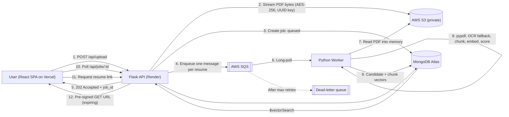

# AI-Powered Enterprise ATS

> A scalable applicant tracking system that ranks resumes by semantic meaning rather than keyword overlap, built on an SQS-backed asynchronous pipeline, private S3 storage, and MongoDB Atlas Vector Search.

   

## System Architecture



## Core Features

- **Semantic ranking:** `all-MiniLM-L6-v2` embeddings with cosine similarity, so synonyms and related terminology count.
- **Full-document scoring:** 200-token windows with a 50-token overlap work around the model's 256-token limit. The score is the mean of the top-k chunk similarities.
- **Asynchronous bulk processing:** the API returns `202 Accepted` with a `job_id`. A standalone worker consumes SQS, and the UI polls for progress.
- **Reliable by design:** idempotent workers, retries, a dead-letter queue and graceful `SIGTERM` handling.
- **Vector search:** native MongoDB Atlas `$vectorSearch` over chunk embeddings, which enables talent-pool search across jobs.
- **Job isolation:** candidates and leaderboards are scoped per `job_id`.
- **Zero local storage:** PDFs go from memory to S3 with AES-256 encryption and UUID object keys.
- **Private by default:** no public-read access. Resumes open through short-lived pre-signed URLs.
- **Scanned-resume support:** in-memory `pypdf` extraction with a `pdf2image` and Tesseract OCR fallback.
- **Evaluation harness:** NDCG@10 and MRR against TF-IDF and truncated-embedding baselines.

## Tech Stack

| Layer | Technology |
|---|---|
| Frontend | React, Vite, Bootstrap (deployed on Vercel) |
| API | Python, Flask, Flask-CORS (deployed on Render) |
| Worker | Python, boto3, long-polling AWS SQS |
| AI / NLP | sentence-transformers (`all-MiniLM-L6-v2`), spaCy, NumPy |
| Extraction | pypdf, pdf2image, pytesseract (Tesseract OCR, Poppler) |
| Storage and queue | AWS S3, AWS SQS (with DLQ) |
| Database | MongoDB Atlas, pymongo, Atlas Vector Search |
| Evaluation | scikit-learn (TF-IDF baseline, NDCG), custom harness |

## Local Setup

### Prerequisites

- Python 3.11+, Node.js 18+
- A MongoDB Atlas cluster (the free tier works)
- An AWS account with a **private** S3 bucket and an SQS queue (plus an optional DLQ)
- **Tesseract OCR** and **Poppler** for the OCR fallback.
  - Windows: install the UB Mannheim Tesseract build and the Poppler for Windows binaries.
  - Linux: `apt install tesseract-ocr poppler-utils`.

### 1. Clone and configure

```bash
git clone <your-repo-url>
cd <repo>
python -m venv venv
# Windows: venv\Scripts\activate    macOS/Linux: source venv/bin/activate
pip install -r requirements.txt
python -m spacy download en_core_web_sm
```

Create a `.env` file in the backend root (never commit it):

```env
MONGO_URI=mongodb+srv://<user>:<password>@<cluster>.mongodb.net/
MONGO_DB=resume_ranker_db
S3_BUCKET_NAME=<your-private-bucket>
SQS_QUEUE_URL=<your-queue-url>
AWS_REGION=<region>
AWS_ACCESS_KEY_ID=<key>
AWS_SECRET_ACCESS_KEY=<secret>
PRESIGN_TTL_SECONDS=300
CORS_ORIGINS=http://localhost:5173
# Windows only (OCR):
TESSERACT_CMD=C:\Program Files\Tesseract-OCR\tesseract.exe
POPPLER_PATH=C:\poppler\Library\bin
```

In `frontend/.env`:

```env
VITE_API_URL=http://127.0.0.1:5000
```

### 2. Create the Atlas Vector Search index

On the `chunks` collection, create a vector search index named `chunk_vec`:

```json
{
  "fields": [
    { "type": "vector", "path": "embedding", "numDimensions": 384, "similarity": "cosine" },
    { "type": "filter", "path": "job_id" }
  ]
}
```

### 3. Run all three services concurrently

The system is decoupled, so the **API, the Worker and the UI must all be running at the same time**. Without the worker, uploads are accepted but jobs stay in `queued`. Open three terminals:

```bash
# Terminal 1: API
python app.py

# Terminal 2: Worker
python worker.py

# Terminal 3: UI
cd frontend
npm install
npm run dev
```

Open `http://localhost:5173`.

### 4. Run the evaluation harness (optional)

```bash
python eval/run_eval.py
```

## Configuration Notes

- Run the worker as a separate process or container. It needs the ML dependencies and OCR binaries, and the API does not.
- Keep the S3 bucket private, with Block Public Access enabled. The API serves resumes only through pre-signed URLs.
- Tune `CHUNK_TOKENS`, `CHUNK_OVERLAP`, `TOP_K_CHUNKS`, `WORKER_THREADS` and `MAX_FILES_PER_UPLOAD` through environment variables.
